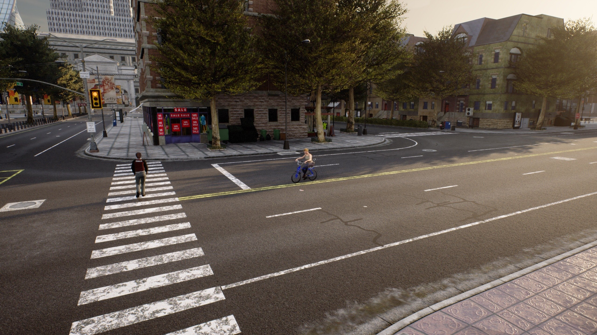
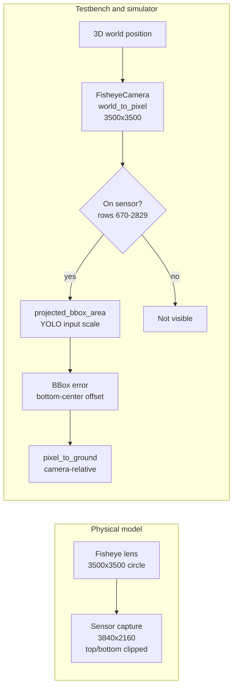

<h1 align="center">bikeped</h1>

<p align="center">
  <strong>Real-time collision warnings for pedestrians and cyclists at urban intersections.</strong><br/>
  One fisheye camera, one Jetson Orin, 30 fps.
</p>

<p align="center">
  <a href="https://arxiv.org/abs/2604.17046"></a>
  <a href="https://huggingface.co/datasets/mehmetkeremturkcan/bikeped"></a>
  <a href="https://mkturkcan.github.io/bikeped/start/"></a>
  
  
  
</p>

<p align="center">
  <a href="https://mkturkcan.github.io/bikeped/">Project page</a> ·
  <a href="https://arxiv.org/abs/2604.17046">Paper</a> ·
  <a href="https://mkturkcan.github.io/bikeped/start/">Documentation</a> ·
  <a href="https://mkturkcan.github.io/bikeped/simulator/">Browser simulator</a> ·
  <a href="https://huggingface.co/datasets/mehmetkeremturkcan/bikeped">Dataset</a> ·
  <a href="bridge_starter/">Deployment kit</a>
</p>

<p align="center">
  
</p>

bikeped is a prototype warning system for crossings that cyclists and pedestrians share. A fisheye
camera on a pole watches the crosswalk, a Jetson Orin detects and tracks the people in view, places
them on the ground plane and decides on every frame whether a cyclist is closing on someone who is
crossing. When one is, a light and a sound at the crosswalk say so.

This repository holds the decision logic that runs on the device, the testbench that produces every
number in the [paper](https://arxiv.org/abs/2604.17046), a scenario library, a CARLA renderer for
Unreal Engine 4 and 5, the fisheye calibration tools and a starter kit for another intersection.

Under conformance testing with fisheye localization error, the selected configuration reaches 93.3%
sensitivity and 92.3% specificity with a mean warning budget of 3.3 s. The first two figures come
out of `python decision_testbench.py --compare` in a few minutes on a laptop.

## Contents

| Path | What it is |
|---|---|
| [`decision_pipeline.py`](decision_pipeline.py) | The three-stage decision module. The same file runs on the device and in the testbench. |
| [`decision_testbench.py`](decision_testbench.py) | Offline evaluation: fisheye localization error, detection failures, latency sweep, Monte Carlo runs and the parameter optimizer. |
| [`run_experiments.py`](run_experiments.py) | One command for every table and figure in the paper. |
| [`bikeped/scenarios/`](bikeped/scenarios/) | The scenario library: the 24 conformance scenarios, the extended and stress suites, path builders and seeded generators. |
| [`bikeped/sim/`](bikeped/sim/) | The CARLA renderer: camera rigs with a calibrated fisheye, weather presets, ground truth, overlays and video output. |
| [`simulator/`](simulator/) | The browser simulator, a single HTML file. Hosted at [mkturkcan.github.io/bikeped/simulator](https://mkturkcan.github.io/bikeped/simulator/). |
| [`calibration/`](calibration/) | Fisheye intrinsic calibration by perspective remapping and bundle adjustment. |
| [`bridge_starter/`](bridge_starter/) | A self-contained live system to adapt to another intersection. |
| [`tools/`](tools/) | Docs build, latency report, detector evaluation, crosswalk extraction for CARLA maps. |
| `config.yaml`, `camera_calibration.json`, `crosswalks.json` | Runtime parameters, calibrated intrinsics, and crosswalk geometry of the default CARLA map. |

## Install

Python 3.10 or newer.

```bash
pip install -r requirements.txt
```

That covers the testbench, the scenario library and the imaging half of the renderer. Rendering in
CARLA also needs a CARLA server and the Python client of the same version, described under
[CARLA rendering](#carla-rendering). The detector, TensorRT and the indicator hardware are only
needed for a live deployment and are covered in [`bridge_starter/`](bridge_starter/).

## Reproduce the paper

```bash
python run_experiments.py                   # everything, about 45 minutes
python run_experiments.py --skip-optimizer  # without the optimizer, about 10 minutes
```

Individual experiments:

```bash
python decision_testbench.py --compare                  # Table 2, with fisheye localization error
python decision_testbench.py --no-bbox-noise --compare  # the same without localization error
python decision_testbench.py --latency-sweep            # Figure 4, camera latency sweep
python decision_testbench.py --monte-carlo --mc-trials 50
python decision_testbench.py --optimize                 # differential evolution, about 30 minutes
python decision_testbench.py --error-map                # bounding-box localization error
python run_height_pitch_sweep.py                        # Figure 8b, about 30 minutes
python generate_figures.py                              # publication figures
python sim_visualizer.py --no-display                   # schematic scenario videos
```

## Scenarios

A scenario is a list of agents, each with timed waypoints on the ground plane. The testbench
interpolates them at 30 fps and a kinematic safety model labels every frame as dangerous or not.

```bash
python -m bikeped.scenarios list                      # every suite
python -m bikeped.scenarios show fast-approach        # one scenario with its paths
python -m bikeped.scenarios evaluate --suite extended # run the decision pipeline over a suite
python -m bikeped.scenarios generate --family time-gap --n 20 --seed 0 --out sweep.json
```

<!-- suites:start -->
| Suite | Scenarios | Purpose |
|---|---:|---|
| `conformance` | 24 | The scenarios behind every number in the paper. 21 contain ground-truth danger intervals. |
| `extended` | 41 | Turning conflicts, occlusion, yielding riders, groups, micromobility and true negatives. |
| `stress` | 8 | Dense scenes for throughput and tracker load. |
<!-- suites:end -->

The conformance scenarios, with paired schematic and CARLA videos and per-frame labels, are also
published as a [dataset](https://huggingface.co/datasets/mehmetkeremturkcan/bikeped).

## Browser simulator

[`simulator/index.html`](simulator/index.html) runs the decision pipeline in JavaScript with the
camera model, detection failures and latency exposed as controls. Open the file directly or use
the [hosted copy](https://mkturkcan.github.io/bikeped/simulator/).

## CARLA rendering

`bikeped.sim` renders any scenario in CARLA from the waypoints that define it. Actors stay on their
scripted positions, so the ground-truth labels of the testbench apply to the rendered frames.

```bash
# start a server (or point --host/--port at one that is running)
python -m bikeped.sim server --engine ue4 --root /opt/carla

# what the server can do: engine, maps, cyclist and walker blueprints, sensors
python -m bikeped.sim probe

# render one scenario from the pole camera and through the fisheye, with the overlay
python -m bikeped.sim render --scenario bike-approaches-ped \
    --rig pole,fisheye --weather golden_hour --layout split
```

<!-- engines:start -->
| | Unreal Engine 4 | Unreal Engine 5 |
|---|---|---|
| CARLA version | 0.9.14 to 0.9.16 | 0.10.0 |
| Launcher | `CarlaUE4.sh` | `CarlaUnreal.sh` |
| Python client | `pip install carla==0.9.16` | the cp310 wheel in the CARLA package |
| Cyclists | bicycle blueprints | no rideable two-wheeler in 0.10.0, see below |
<!-- engines:end -->

Views are `pole`, `fisheye`, `chase`, `orbit`, `street` and `bev`. The fisheye view is rendered as
cube faces and remapped through `camera_calibration.json`, so a simulated frame has the geometry of
a frame from the deployed camera. Weather presets are `clear_noon`, `golden_hour`, `overcast`,
`light_rain`, `heavy_rain`, `dusk`, `clear_night`, `wet_night` and `fog`.

Each run writes a directory:

```
renders/ue4_bike-approaches-ped_golden_hour/
├── manifest.json          run metadata, camera models, per-frame agents, states and danger labels
├── video/pole.mp4         clean view
├── video/pole_overlay.mp4 view with boxes, trails, state and timeline
├── video/composite.mp4    the chosen layout
├── gt/pole.jsonl          per-frame 2D boxes, 3D corners and visibility
└── stills/                first frame, first alert, closest approach
```

`python -m bikeped.sim export RUN_DIR --format coco` (or `yolo`) turns a run into a detection
dataset.

## Deploying on another intersection

Copy [`bridge_starter/`](bridge_starter/) into your own project, then:

1. Edit the USER CONFIG block at the top of [`bridge.py`](bridge_starter/bridge.py): camera
   intrinsics, MQTT broker, sound paths, model name.
2. Run `python bridge.py`. On the first run it downloads `yolo11xxl.pt` from Hugging Face and tries
   to export a TensorRT engine.

The kit ships a `SimulatedLight` that prints colour transitions, so the system runs end to end
without indicator hardware. Sounds are optional and are skipped when the WAV files are missing.
[`bridge_starter/README.md`](bridge_starter/README.md) covers tuning `DEC_PROX_MIN_M` and the
rider-on-bike suppression for your detector and camera geometry.

## How it works

### Perception

The testbench replicates the geometry of the deployed camera:



`FisheyeCamera` in [`decision_testbench.py`](decision_testbench.py) implements the equidistant model
`r = f·θ` with optional `k1`, `k2` polynomial terms loaded from `camera_calibration.json`. Forward
and inverse projections agree to floating-point precision and match the deployed ground-coordinate
lookup table when both read the same calibration file.

### Decision

Three stages run in order on every frame:

1. Pedestrian presence. With no pedestrian in view the state is `IDLE`.
2. Cyclist memory. With no cyclist in the last *N* frames the state is `SAFE`.
3. Pairwise closing check. For each cyclist and pedestrian between `d_min` and `d_max` apart, the
   distance at frame *t* is compared with the distance at frame *t − k*, using the past positions
   of both. A closing pair with a moving cyclist gives `ALERT`, and no closing pair gives `WARNING`.

The selected parameters come from the optimizer: `N = 58` frames, `d = [1.9, 24.8]` m, lookback
`k = 2`, and a `d_max` that grows to the cyclist's stopping distance at speed. The braking model
uses 85th-percentile field measurements (reaction time 0.84 s, deceleration 1.96 m/s²). The E-Scooter
and Accelerating E-Bike scenarios use the e-bicycle profile (6.0 m/s²).

## Documentation

The site at <https://mkturkcan.github.io/bikeped/> is built with MkDocs Material from
[`docs_src/`](docs_src/) and served by GitHub Pages from [`docs/`](docs/).

```bash
pip install mkdocs-material "mkdocstrings[python]" pymdown-extensions
python tools/build_docs.py            # build docs/
python tools/build_docs.py --serve    # live preview
```

Commit the regenerated `docs/` folder to publish.

## Tests

```bash
pip install pytest
python -m pytest tests -q
```

The tests run without CARLA. The renderer is exercised against an in-memory stand-in for the CARLA
API, configured once as a 0.9.16 server and once as a 0.10.0 server.

## Repository layout

```
bikeped/
├── decision_pipeline.py           three-stage decision module, shared with the device
├── decision_testbench.py          offline evaluation, optimizer, Monte Carlo
├── run_experiments.py             one-command paper reproduction
├── run_height_pitch_sweep.py      camera height and pitch placement sweep
├── generate_figures.py            publication figures
├── sim_visualizer.py              schematic scenario videos
├── crosswalk_analysis.py          deployment and road-width analysis
├── carla_scenario.py              previous CARLA entry point, forwards to bikeped.sim
├── config.yaml                    runtime parameters
├── camera_calibration.json        calibrated intrinsics, read by every script
├── crosswalks.json                crosswalk geometry extracted from Town10HD_Opt
│
├── bikeped/
│   ├── scenarios/                 scenario library and its command line
│   └── sim/                       CARLA renderer for UE4 and UE5 and its command line
│
├── calibration/                   fisheye calibration
├── bridge_starter/                deployment kit, self-contained
├── simulator/                     browser simulator
├── tools/                         docs build, latency report, detector evaluation, crosswalk extraction
├── tests/                         unit and end-to-end tests, no CARLA needed
├── docs_src/                      documentation sources and the project page
└── docs/                          built site, served by GitHub Pages
```

## Citation

```bibtex
@misc{turkcan2026realtimebikepedestriansafetywideangle,
  title         = {A Real-Time Bike-Pedestrian Safety System with Wide-Angle Perception and Evaluation Testbed for Urban Intersections},
  author        = {Mehmet Kerem Turkcan},
  year          = {2026},
  eprint        = {2604.17046},
  archivePrefix = {arXiv},
  primaryClass  = {cs.CV},
  url           = {https://arxiv.org/abs/2604.17046}
}
```
