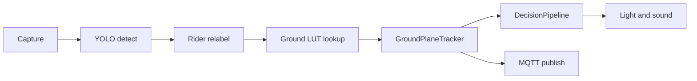

# Bridge starter kit

`bridge_starter/` is a single-folder version of the live system: capture, detection, ground-plane projection, tracking, the decision pipeline, an indicator light and MQTT publishing in one script. This page covers what the kit contains, every constant in its `USER CONFIG` block, how to run it and what it publishes.

The live MQTT bridge of the reference deployment (`mqtt_bridge.py`) is not part of this repository. The kit is the version to copy when you set the system up at another intersection.

## Contents

| File | Purpose |
|---|---|
| `bridge.py` | The whole live loop. The `USER CONFIG` block at the top holds everything a new site changes. |
| `decision_pipeline.py` | Copy of the top-level [`decision_pipeline.py`](../api/decision_pipeline.md), so the folder runs on its own. |
| `requirements.txt` | numpy, opencv-python, pyyaml, ultralytics, huggingface_hub, paho-mqtt. |
| `README.md` | The guide this page is based on. |

## Install

Python 3.10 or newer. A CUDA-capable GPU is recommended for real-time throughput.

```bash
cd bridge_starter
pip install -r requirements.txt
```

Two extras are optional:

```bash
pip install play-sounds   # audio cues
pip install tensorrt      # TensorRT engine export, platform-specific
```

## Run

```bash
python bridge.py                    # use the USER CONFIG defaults
python bridge.py --video clip.mp4   # read a video file instead of the webcam
python bridge.py --no-mqtt          # no broker connection
python bridge.py --no-window        # headless, for example under systemd
```

| Flag | Effect |
|---|---|
| `--video PATH` | Overrides `VIDEO_FILE` and forces `USE_WEBCAM = False`. |
| `--no-mqtt` | Skips the broker connection. Tracks are not published. |
| `--no-window` | Disables the `cv2.imshow` preview. With the window on, ++q++ quits. |

The first run downloads the detector weights and tries a one-time TensorRT export. The README shows this console output for a fresh checkout:

```text
[model] yolo11xxl.pt not found locally — downloading from huggingface.co/mehmetkeremturkcan/YOLO11xxl
[model] saved to models/yolo11xxl.pt
[model] no TensorRT engine found at models/yolo11xxl.engine
[model] attempting one-time export yolo11xxl.pt -> yolo11xxl.engine (this can take a few minutes) ...
[model] export OK: models/yolo11xxl.engine
[bev] building ground LUT (3500x3500) ...
[bev] valid pixels: 9621123/12250000
[mqtt] connecting to mqtt.example.com:1883 ...
======================================================================
 Source: WEBCAM
 Model:  models/yolo11xxl.engine
 MQTT:   enabled (mqtt.example.com)
 Window: on  (q to quit)
======================================================================
[light] BLUE
[light] GREEN
[light] RED
...
```

If the export fails, the script prints a warning and runs the `.pt` weights. Each `[light]` line is printed once per colour change.

## Frame loop



For each frame, `bridge.py` does the following.

1. Runs `model.predict` on the raw frame with `YOLO_CONF`, `YOLO_IMGSZ` and `YOLO_CLASSES`.
2. Relabels `person` boxes that sit on a bicycle or motorcycle box as class 1, so a rider and their bike become one cyclist. See [Tuning](tuning.md#rider-on-bike-suppression).
3. Takes the bottom-centre pixel of each box, shifts it into the padded and cropped frame, and looks it up in a precomputed table of ground coordinates. The table is built once at start-up from the `CAMERA_*` constants. Its frame is camera-relative: x forward, y right, in metres. Pixels whose ray does not reach the ground are dropped.
4. Updates `GroundPlaneTracker`, a greedy nearest-neighbour tracker in ground coordinates with a 3.0 m match radius, same-class matching and a per-class speed gate. A track is reported after two matched detections.
5. Feeds each track to `DecisionPipeline.update_track`, then calls `evaluate` with class 0 as pedestrians and classes 1 and 3 as cyclists. Other classes are tracked and published but do not enter the decision.
6. Sets the light colour, plays a sound if one is configured, publishes the tracks, and draws the preview.

## USER CONFIG

Every constant in the block, with the value the kit ships.

### Video source

| Constant | Default | Unit | Meaning |
|---|---|---|---|
| `USE_WEBCAM` | `True` | | Read camera index 0. `False` plays `VIDEO_FILE`. |
| `VIDEO_FILE` | `"input.mp4"` | | Video used when `USE_WEBCAM` is `False`. |

### Camera

| Constant | Default | Unit | Meaning |
|---|---|---|---|
| `CAMERA_HEIGHT_M` | `3.6576` | m | Mounting height above the ground. |
| `CAMERA_FOV_DEG` | `197.9` | deg | Field of view across the image circle. |
| `CAMERA_RADIUS_PX` | `1750` | px | Radius of the image circle. |
| `CAMERA_PITCH_DEG` | `0.0` | deg | Tilt of the optical axis. Negative looks down. |
| `CAMERA_CX`, `CAMERA_CY` | `1752.69`, `1804.54` | px | Optical centre in the cropped frame. |
| `CAMERA_K1`, `CAMERA_K2` | `0.0`, `0.0` | | Radial terms of `r = f (θ + k1 θ³ + k2 θ⁵)`. Zero turns them off. |
| `CAMERA_PROJECTION` | `"linear"` | | `linear`, `equalarea`, `orthographic` or `stereographic`. See [projection names](../reference/config.md#projection-names). |
| `INPUT_PAD_SIZE` | `3840` | px | Side of the square the frame is padded to. |
| `INPUT_CROP_SIZE` | `3500` | px | Side of the centre crop taken from the padded square. |

The defaults are the values in `camera_calibration.json`. Replace them with the output of your own [calibration](../calibration/index.md).

### Detector

| Constant | Default | Unit | Meaning |
|---|---|---|---|
| `YOLO_HF_REPO` | `"mehmetkeremturkcan/YOLO11xxl"` | | Hugging Face repository the weights come from. |
| `YOLO_HF_FILE` | `"yolo11xxl.pt"` | | Weights file in that repository. |
| `YOLO_LOCAL_DIR` | `"models"` | | Folder for the weights and the exported engine. |
| `YOLO_IMGSZ` | `1280` | px | Inference size, also used for the engine export. |
| `YOLO_CONF` | `0.1` | | Confidence threshold. |
| `YOLO_DEVICE` | `"cuda"` | | `"cuda"` or `"cpu"`. |
| `YOLO_CLASSES` | `[0, 1, 2, 3, 5, 7]` | | COCO class IDs kept: person, bicycle, car, motorcycle, bus, truck. |

### MQTT

| Constant | Default | Unit | Meaning |
|---|---|---|---|
| `MQTT_ENABLED` | `True` | | Publish tracks. |
| `MQTT_BROKER` | `"mqtt.example.com"` | | Broker host name. Change it. |
| `MQTT_PORT` | `1883` | | Broker port. |
| `MQTT_TOPIC` | `"bikeped/intersection/tracks"` | | Topic for track messages. |
| `MQTT_USERNAME`, `MQTT_PASSWORD` | `None`, `None` | | Credentials. Both must be set to enable authentication. |
| `MQTT_CLIENT_ID` | `"bikeped_bridge"` | | Client identifier. |
| `MQTT_QOS` | `0` | | Quality of service for publishes. |

### Audio

| Constant | Default | Unit | Meaning |
|---|---|---|---|
| `ALERT_SOUND` | `"alert.wav"` | | Played when the state is `alert`. |
| `SAFE_SOUND` | `"safe.wav"` | | Played when the state is `safe`. |
| `SOUND_THROTTLE_FRAMES` | `60` | frames | Minimum gap between two plays of the same sound. |

### Decision pipeline

| Constant | Default | Unit | Meaning |
|---|---|---|---|
| `DEC_BIKE_MEMORY_FRAMES` | `58` | frames | How long a cyclist detection keeps stage 2 open. |
| `DEC_PROX_MIN_M` | `1.9` | m | Lower bound on the bike to pedestrian distance that can alert. |
| `DEC_PROX_MAX_M` | `24.8` | m | Upper bound on that distance before the speed-adaptive extension. |
| `DEC_PROX_SPEED_MIN` | `0.147` | m | Minimum cyclist displacement over the lookback. |
| `DEC_LOOKBACK_FRAMES` | `2` | frames | Lookback `k` of the closing check. |
| `DEC_SPEED_ADAPTIVE` | `True` | | Extend the upper bound to the cyclist's stopping distance. |
| `DEC_REACTION_S` | `0.84` | s | Cyclist perception-reaction time in the stopping distance. |
| `DEC_DECEL_MS2` | `1.96` | m/s² | Cyclist deceleration in the stopping distance. |
| `DEC_MAX_RANGE_M` | `25.0` | m | Agents farther than this from the camera are ignored. |
| `DEC_FPS` | `30` | frames/s | Frame rate the memory length is defined against. |
| `RIDER_X_OVERLAP_FRAC` | `0.6` | | Horizontal overlap threshold of the rider test. |
| `RIDER_Y_OVERLAP_FRAC` | `0.3` | | Vertical overlap threshold of the rider test. |

The `DEC_*` values are the optimizer-derived parameters from the paper and match the `decision` block of `config.yaml`. [Tuning](tuning.md) explains when to move them and [The decision pipeline](../system/decision.md) explains what each stage does.

### Latency profiling and display

| Constant | Default | Unit | Meaning |
|---|---|---|---|
| `LATENCY_ENABLED` | `True` | | Record per-step timings. |
| `LATENCY_SAVE_PATH` | `"latency_data.npy"` | | Output array. |
| `LATENCY_SAVE_INTERVAL` | `500` | records | Checkpoint period. A final save happens at exit. |
| `LATENCY_WARMUP_FRAMES` | `30` | frames | Frames skipped before recording starts. |
| `SHOW_WINDOW` | `True` | | Preview window with boxes and the state name. |
| `WINDOW_NAME` | `"bikeped bridge"` | | Window title. |
| `DEBUG`, `VERBOSE` | `False`, `False` | | `VERBOSE` is passed to the detector and enables MQTT publish error messages. |

## MQTT message

`publish_tracks` sends one JSON message per frame to `MQTT_TOPIC`. It contains the confirmed tracks in ground coordinates.

```json
{
  "timestamp": "2026-05-04T14:03:22.418113Z",
  "frame_number": 1284,
  "objects": [
    {
      "track_id": 17,
      "class_id": 0,
      "position": {"x": 6.42, "y": -1.87, "distance": 6.69}
    }
  ]
}
```

| Field | Type | Meaning |
|---|---|---|
| `timestamp` | string | UTC time of the publish, ISO 8601 with a trailing `Z`. |
| `frame_number` | int | Count of frames read since start. |
| `objects[].track_id` | int | Identifier assigned by `GroundPlaneTracker`. |
| `objects[].class_id` | int | COCO class ID after the rider relabel. |
| `objects[].position.x`, `.y` | float | Ground position in metres, x forward and y right of the camera. |
| `objects[].position.distance` | float | `sqrt(x² + y²)`, the ground distance from the camera. |

The values above are an example of the structure. The decision state is not part of the message. It drives the light and the sounds on the device.

## Related

- [Tuning for a new site](tuning.md)
- [Hardware and I/O](hardware.md)
- [Fisheye calibration](../calibration/index.md)
- [Configuration reference](../reference/config.md)
